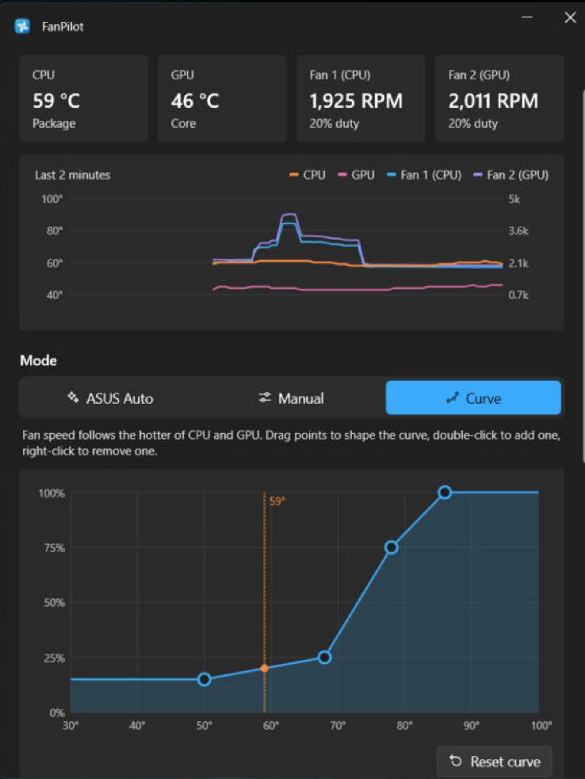

# FanPilot

Fan control for ASUS laptops on Windows. Pick ASUS's own fan behaviour, a fixed speed, or a
temperature curve you draw yourself, from a window or the tray. FanPilot measures your fans once so
it never runs them slower than they can safely spin, and hands control back to ASUS whenever
something looks wrong.



## Features

- **Three modes**
  - **ASUS Auto**: the laptop's firmware controls the fans, as if FanPilot weren't there.
  - **Manual**: one fixed speed for every fan, with Silent, Balanced, Performance and Max presets.
  - **Curve**: speed follows temperature along a curve you edit by dragging points.
- **Fan setup.** On first launch, FanPilot offers to measure each fan: how slowly it can spin
  before it stalls, the speed it needs to start again, and how fast ASUS runs it at idle. That
  sets the minimum speed and the Silent preset for your laptop. It takes about a minute and a half, and you
  can skip it and run it later from Settings. Until it runs, FanPilot never goes below 30%.
  Run it with heavy apps closed: it needs the CPU below 70 °C, because ASUS firmware takes over
  the fans when the laptop is hot, which would make the measurements meaningless.
- **CPU and GPU temperature.** The GPU temperature comes from the same source Task Manager uses,
  so a sleeping NVIDIA Optimus GPU is never woken just to read it.
- **Tray icon** with live temperatures and fan speeds, mode switching and presets.
- **No UAC prompts.** The fans are driven by a small Windows service, so the window and tray
  icon run as you. Pin FanPilot to the taskbar and it opens like any other app.
- **Copy diagnostics.** One button copies your model, driver versions, fan setup results and
  recent log, ready to paste into a bug report.

## Safety

- **Never below the minimum.** FanPilot never sets a fan below the minimum found by fan setup
  (30% before fan setup has run).
- **Thermal override.** In Manual and Curve modes, the fans go to 100% when the CPU reaches 95 °C
  or the GPU reaches 87 °C. Both thresholds are adjustable. The override lets go 10 °C lower.
- **Hand-back to ASUS.** The fans go back to the firmware when:
  - the service stops or crashes
  - Windows goes to sleep (on some models a fixed speed survives sleep and can leave the fans stopped)
  - the CPU temperature can't be read for 5 seconds
  - fan setup is cancelled
- **Fans that don't respond.** On some models a fan ignores speed commands. Fan setup detects this,
  and that fan stays with ASUS.
- **Other fan apps.** If G-Helper or AsusFanControl is running too, FanPilot warns you, because two
  apps writing fan speeds will fight.

## Requirements

- Windows 10 (1809 or later) or Windows 11, x64. ARM64 laptops are not supported.
- An ASUS laptop where **Fan Diagnosis in MyASUS works**. FanPilot uses the same ASUS library.
- The **ASUS System Control Interface** driver, which MyASUS installs. The installer warns if it's
  missing.

See [docs/COMPATIBILITY.md](docs/COMPATIBILITY.md) for laptops that have been tested, and please
add yours.

## Install

1. Download `FanPilot-Setup-<version>.exe` from the
   [latest release](https://github.com/MarceloGoluboff/FanPilot/releases/latest).
2. Run it. FanPilot isn't code-signed yet, so Windows SmartScreen may say it "protected your PC".
   Click **More info**, then **Run anyway**. The installer's SHA-256 is listed in
   `SHA256SUMS.txt` on the release page if you want to check it.
3. Open FanPilot from Start, run fan setup when it asks, and pin it to the taskbar if you like
   (right-click it in Start, then **Pin to taskbar**).

To uninstall, use **Settings > Apps**. Uninstalling stops the service, which hands the fans back to
ASUS.

## How it works

ASUS System Control Interface driver 3.1.41.0 and later only accept fan commands from a process
running as LocalSystem. So FanPilot is one program with two roles:

- **The `FanPilot` service** (LocalSystem, starts automatically) loads `AsusWinIO64.dll` from the
  ASUS driver store, runs the fan engine once a second, and keeps its settings and fan setup
  results in its own profile (`C:\Windows\System32\config\systemprofile\AppData\Local\FanPilot`),
  where standard users can't tamper with them.
- **The window and tray icon** run as you and talk to the service over a named pipe, `FanPilot`.
  Only users signed in to the PC (at the console or over Remote Desktop) can open the pipe.

FanPilot doesn't include ASUS's DLL. It uses the copy the ASUS driver installed, so it always
matches your driver version.

## Building from source

```
winget install Microsoft.DotNet.SDK.8
winget install JRSoftware.InnoSetup
dotnet test tests\FanPilot.Tests
powershell -ExecutionPolicy Bypass -File scripts\build.ps1
```

The installer lands in `dist\`. The version comes from `Directory.Build.props`.

### Working without ASUS hardware

`FanPilot.exe --host --simulate=2` runs the service's work in the foreground against simulated fans
(1 to 3; with 3, the third ignores commands like some real models do). Start the window normally and
it connects. Stop the real `FanPilot` service first (`net stop FanPilot`), because both use the
same pipe.

### Command line

| Flag | What it does |
| --- | --- |
| `--tray` | Start with only the tray icon (used at sign-in). |
| `--service` | Service entry point, for the Service Control Manager. |
| `--install-service` | Create or update the service and start it. Needs admin; the installer runs it. |
| `--host [--simulate[=N]]` | Run the service's work in the foreground, optionally with simulated fans. |
| `--diag` | Run the fan setup measurement from the command line and print the results without saving them. Must run as SYSTEM with the service stopped. |

Logs: `service.log` in the service's folder above, and `%AppData%\FanPilot\log.txt` for the window.

## Roadmap

- Performance modes (Silent, Balanced, Turbo) and firmware fan curves on ROG and TUF models,
  through ASUS's ACPI interface. These would be implemented from the documented interface in the
  Linux kernel's `asus-wmi` driver.
- Separate manual speeds per fan.
- Code signing (for example through SignPath) and a winget package.

## Contributing

Bug reports, compatibility reports and pull requests are welcome. See
[CONTRIBUTING.md](CONTRIBUTING.md). For security issues, see [SECURITY.md](SECURITY.md).

## Acknowledgements

[AsusFanControl](https://github.com/Karmel0x/AsusFanControl) by Karmel0x identified the
`AsusWinIO64.dll` entry points FanPilot uses. See [THIRD-PARTY-NOTICES.md](THIRD-PARTY-NOTICES.md).

## Disclaimer

FanPilot is not affiliated with or endorsed by ASUSTeK Computer Inc. ASUS, ROG, TUF, Vivobook,
Zenbook and MyASUS are trademarks of ASUSTeK Computer Inc. Changing fan speeds is at your own risk;
FanPilot's safety features reduce that risk but can't remove it.

## License

[MIT](LICENSE)
